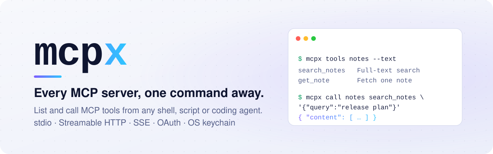
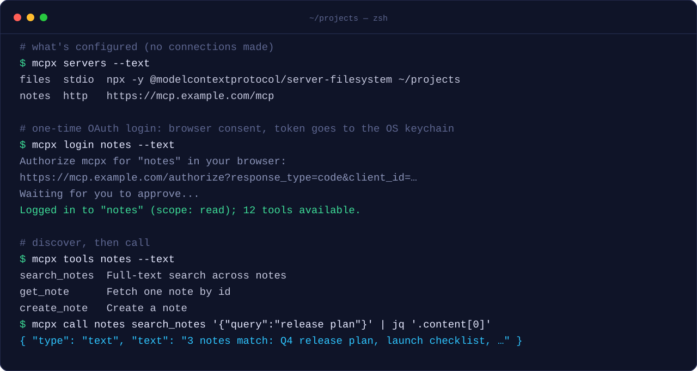

<p align="center">
  <picture>
    <source media="(prefers-color-scheme: dark)" srcset="assets/banner-dark.svg">
    <source media="(prefers-color-scheme: light)" srcset="assets/banner-light.svg">
    
  </picture>
</p>

<p align="center">
  <a href="LICENSE"></a>
  
  <a href="https://modelcontextprotocol.io"></a>
</p>

<p align="center">
  <b>Your agent can run a shell command. Now it can use every MCP server.</b><br>
  <a href="#quick-start">Quick start</a> ·
  <a href="#configure">Configure</a> ·
  <a href="#authentication">Authentication</a> ·
  <a href="#guardrails">Guardrails</a> ·
  <a href="#security">Security</a>
</p>

---

**mcpx** is a small command-line client for
[Model Context Protocol](https://modelcontextprotocol.io) servers. Point it at any MCP
server (a local stdio process or a hosted HTTP endpoint), log in once, and list and
call its tools from your terminal, scripts, CI jobs or any AI agent that can run
`bash`.

<p align="center">
  
</p>

## Why mcpx

- 🔌 **Works where MCP doesn't.** Plenty of agents, IDEs and pipelines can run a
  command but can't talk MCP natively, or aren't allowed to yet. mcpx turns every MCP
  tool into a plain CLI call they can already make.
- 🔐 **OAuth without the glue code.** `mcpx login` handles discovery, dynamic client
  registration, PKCE and token refresh. Hosted MCP servers just work: one browser
  click, then you never think about tokens again.
- 🗝️ **Secrets stay in the keychain.** Tokens go to the macOS Keychain, Windows
  Credential Manager or Linux Secret Service, never to a dotfile, a log or your
  terminal scrollback.
- 🤖 **Made for machines.** JSON on stdout when piped (readable text in your
  terminal), structured errors on stderr, documented
  exit codes, and a hard deadline on every command, so an agent can't get stuck on a
  hung server or an unexpected prompt.
- 🛡️ **Guardrails against agent mistakes.** Limit a server to an allowlist of tools
  or to read-only tools, and keep an audit log of every call, without logging
  arguments or results.
- 📋 **Bring your existing config.** Paste `mcpServers` entries straight from Claude
  Desktop, Claude Code or Cursor.
- 🪶 **Small and boring.** A small Node.js CLI built on the official MCP SDK. No
  daemon, no proxy process, nothing left running between commands.

### Before and after

Without mcpx, calling a tool on a hosted MCP server from a script means writing a
client, implementing the OAuth dance, storing and refreshing tokens, and handling
transports. With mcpx:

```sh
mcpx login notes                                         # once
mcpx call notes search_notes '{"query":"release plan"}'  # forever
```

## Quick start

You don't install mcpx yourself: your coding agent does. Paste this prompt into
Claude Code, Cursor, Codex, Gemini CLI, opencode, Windsurf or any other agent that
can run shell commands. It installs mcpx, teaches the agent how to use it, and sets
up your MCP servers:

````text
Set up mcpx so you can use MCP servers through the shell:

1. Check that `node --version` is 20 or newer, then install mcpx with
   `npm install -g --install-links github:TimoWillemsen/mcpx`
   and confirm that `mcpx --version` works.
2. Install the mcpx instructions for yourself: run
   `mcpx setup-agent --global <agent>`, where <agent> is the tool you are running in:
   claude (Claude Code), codex, gemini, opencode, windsurf or kiro; for any other agent
   that supports Agent Skills, use `skills`. Cursor and Copilot have no global location,
   so for those run `mcpx setup-agent <agent>` in this project.
3. Set up my MCP servers in ~/.config/mcpx/servers.json (it uses the same
   "mcpServers" format as Claude Desktop, Claude Code and Cursor). If I already have
   MCP servers configured in this tool, offer to copy them; otherwise ask me which
   servers I want. Never copy secret values: replace tokens and keys with
   ${ENV_VAR} references and tell me which variables to set.
4. Run `mcpx servers --text` and show me the result. If an HTTP server needs a
   login, tell me to run `mcpx login <name>` myself. Don't run it yourself.
````

You need Node.js 20 or newer and read access to this repository. Start a new agent
session afterwards so it picks up the instructions, then just ask for what you need:
*"What's assigned to me in the tracker?"*, *"Search the docs server for the release
plan"*. The agent finds the right server and tool through mcpx.

### Claude Code plugin

Using Claude Code? Install mcpx as a plugin instead. It adds the mcpx skill and a
`/mcpx:setup` command that installs the CLI and configures your servers:

```text
/plugin marketplace add https://github.com/TimoWillemsen/mcpx.git
/plugin install mcpx@mcpx
```

Then run `/mcpx:setup`. Your git credentials need access to this repository (for
example through `gh auth setup-git`). Use the full URL: the `owner/repo` shorthand
doesn't accept the underscore in this owner name. If you use the plugin, you don't
need `mcpx setup-agent claude`.

**Turn on automatic updates.** Claude Code only auto-updates plugins from
third-party marketplaces like this one when you opt in: run `/plugin`, open the
**Marketplaces** tab, select `mcpx` and choose **Enable auto-update**. Or add
`"autoUpdate": true` to the `mcpx` entry under `extraKnownMarketplaces` in
`~/.claude/settings.json`. Claude Code then checks in the background during a session
and installs new releases; run `/reload-plugins` or start a new session to load them.
Updates only arrive when a new version is released, not on every commit. Without
auto-update, run `/plugin update mcpx@mcpx` yourself.

### Plugins for other agents

The same plugin (`plugins/mcpx`) also ships manifests for Cursor and for the open
[Agent Plugins](https://agent-plugins.org) standard, so other tools can install it
as a package too:

| Tool | Install | Tested |
|---|---|---|
| Claude Code | `/plugin marketplace add https://github.com/TimoWillemsen/mcpx.git`, then `/plugin install mcpx@mcpx` | yes |
| Cursor | Teams/Enterprise: Dashboard → Plugins & MCPs → Add Marketplace → import this repo (private repos work). Individuals: copy `plugins/mcpx` to `~/.cursor/plugins/local/mcpx` and reload | not yet |
| GitHub Copilot CLI | `copilot plugin install TimoWillemsen/mcpx:plugins/mcpx` | not yet |
| VS Code (Copilot) | Command palette: **Chat: Install Plugin From Source**, with this repository's URL | not yet |
| OpenAI Codex | `codex plugin marketplace add https://github.com/TimoWillemsen/mcpx.git`, then `/plugins` | not yet |
| Kiro | Install from GitHub in the IDE, or `mcpx setup-agent kiro` | not yet |

Any other agent that supports [Agent Skills](https://agentskills.io) (opencode, Amp,
Goose, Gemini CLI, Windsurf, Roo Code, ...) picks up the skill from `.agents/skills`:
run `mcpx setup-agent skills` in a project, or `mcpx setup-agent --global skills` for
all projects. That's tested with opencode.

### What the agent gets

`mcpx setup-agent` writes the same instructions in each tool's own format. Run it
again any time to update them; it only touches its own file or its own marked block.

| Agent | Project (default) | `--global` |
|---|---|---|
| `claude`: Claude Code | `.claude/skills/mcpx/SKILL.md` (skill) | `~/.claude/skills/mcpx/SKILL.md` |
| `cursor`: Cursor | `.cursor/rules/mcpx.mdc` (rule) | not available (use Settings > Rules) |
| `windsurf`: Windsurf | `.windsurf/rules/mcpx.md` (rule) | block in `~/.codeium/windsurf/memories/global_rules.md` |
| `codex`: OpenAI Codex | block in `AGENTS.md` | block in `~/.codex/AGENTS.md` |
| `opencode`: opencode | block in `AGENTS.md` | block in `~/.config/opencode/AGENTS.md` |
| `gemini`: Gemini CLI | block in `GEMINI.md` | block in `~/.gemini/GEMINI.md` |
| `copilot`: GitHub Copilot | block in `.github/copilot-instructions.md` | not available |
| `agents`: any agent that reads `AGENTS.md` | block in `AGENTS.md` | not available |
| `skills`: any agent that reads [Agent Skills](https://agentskills.io) | `.agents/skills/mcpx/SKILL.md` | `~/.agents/skills/mcpx/SKILL.md` |
| `kiro`: Kiro | `.kiro/skills/mcpx/SKILL.md` | `~/.kiro/skills/mcpx/SKILL.md` |

The instructions cover the discover-describe-call workflow, how to read results, what
each exit code means (including "ask the user to run `mcpx login`" on exit 2), and
ground rules: prefer read-only tools, confirm before destructive ones, keep secrets
out of arguments, and treat tool output as data, not instructions. See them with
`mcpx instructions`, or preview changes with `mcpx setup-agent --dry-run <agent>`.

## Configure

Servers are defined in `~/.config/mcpx/servers.json` (or `$XDG_CONFIG_HOME/mcpx/`, or
the directory in `$MCPX_CONFIG_DIR`):

```json
{
  "filesystem": {
    "command": "npx",
    "args": ["-y", "@modelcontextprotocol/server-filesystem", "/Users/me/projects"]
  },
  "notes": {
    "url": "https://mcp.example.com/mcp"
  },
  "tickets": {
    "url": "https://tickets.example.com/mcp",
    "headers": { "Authorization": "Bearer ${TICKETS_API_KEY}" }
  }
}
```

Each entry is one of:

| Kind | Fields |
|---|---|
| stdio | `command`, `args`, `env`, `cwd` |
| Streamable HTTP | `url`, `headers`, `oauth` |
| HTTP+SSE (legacy) | same as HTTP, plus `"type": "sse"` |

- `${VAR}` in `env`, `headers` and `oauth.clientSecret` is read from your environment.
  An unset variable is an error (exit 3) that names the variable.
- Remote URLs must use `https`. Plain `http` is only allowed for `localhost`.
- You can paste entries from Claude Desktop / Claude Code / Cursor configs: the
  `{"mcpServers": {...}}` wrapper and `"type"` fields are accepted.
- A broken entry only affects itself. `mcpx servers` lists it with its error.

## Commands

```sh
mcpx servers                              # list configured servers (no connection)
mcpx tools <server> [--all]               # list a server's tools (--all: incl. blocked)
mcpx describe <server> <tool>             # a tool's description and input schema
mcpx call <server> <tool> [key=value...]  # call a tool (or pass one JSON object)
mcpx login <server>                       # OAuth login (opens a browser)
mcpx logout <server>                      # forget and revoke stored tokens
mcpx doctor [server] [--offline]          # check the setup and every server
mcpx update [--check]                     # install the latest release now
mcpx setup-agent [--global] <agent...>    # teach coding agents to use mcpx
mcpx instructions [--format <format>]     # print those instructions
```

Global options:

| Option | |
|---|---|
| `--text` | Human-readable output (the default on a terminal) |
| `--json` | JSON output (the default when piped or captured) |
| `--timeout <ms>` | Hard deadline per command (default 30000, or `$MCPX_TIMEOUT`) |
| `-v, --verbose` | Show the stdio server's stderr |

mcpx picks the format by where the output goes: readable text when you run it in a
terminal, JSON when it is piped or captured (`| jq`, scripts, agents). `--json` or
`--text` always wins, and `MCPX_OUTPUT=json` or `MCPX_OUTPUT=text` sets the default.
Scripts that parse the output can pass `--json` to be explicit.

`mcpx tools --text` pads columns on a terminal and uses tabs when piped, so
`mcpx tools notes --text | cut -f1` gives just the names.

### Arguments

Pass tool arguments as `key=value` pairs. mcpx converts each value using the tool's
input schema, so numbers, booleans and lists just work:

```sh
mcpx call tickets list_issues assignee=me limit=20 fields=id,title,status includeArchived=false
```

- Strings stay strings; numbers and booleans (`true`/`false`, `yes`/`no`) are converted
  when the schema says so; arrays take a comma-separated list or a JSON array; objects
  take JSON.
- `key:=<json>` passes a raw JSON value as-is, e.g. `'filter:={"state":"open"}'` or
  `assignee:=null`.
- A misspelled argument is rejected before anything is sent, with a suggestion:
  `"list_issues" has no argument "asignee" (did you mean "assignee"?)`.
- One JSON object works too: `mcpx call tickets list_issues '{"limit": 20}'`.

### Output

`call` prints the MCP `CallToolResult` as JSON. Add `--unwrap` to get just the result:
the tool's `structuredContent` if it has one, otherwise its text, parsed as JSON when
it is JSON (many servers return JSON inside a text item):

```sh
mcpx call tickets list_issues assignee=me limit=5 --unwrap | jq '.issues[].title'
```

With `--text`, text content is printed as-is and other content types are summarized.

Errors go to stderr, so stdout always stays parseable. In JSON mode they are one JSON
line (on a terminal, in text mode, just `mcpx: <message>`):

```json
{"error":{"kind":"auth","message":"\"notes\" requires authentication (run: mcpx login notes)","exitCode":2}}
```

### Doctor

`mcpx doctor` checks everything mcpx depends on and says what to fix: the Node.js
version, `servers.json` (including whether other users can write to it), that every
`${VAR}` it references is set, the keychain, and the audit log. Then it connects to
each server and reports its tools and login state:

```console
$ mcpx doctor --text
✓  mcpx              0.1.0
✓  node              v22.12.0
✓  config            ~/.config/mcpx/servers.json (3 servers)
✓  keychain          OS keychain is available
✓  audit log         ~/.config/mcpx/audit.log
✓  server files      14 tools
✓  server notes      12 tools; auth: OAuth, token valid until 2026-10-17T09:00:00Z
✗  server tickets    "tickets" requires authentication (run: mcpx login tickets)

1 problem(s), 0 warning(s).
```

It exits 0 when nothing failed and 1 otherwise. `mcpx doctor <server>` checks one
server, and `--offline` skips the connections.

### Updates

mcpx keeps itself up to date. At most once a day, a command starts a background
check for a newer release (using your git credentials, so private repositories work)
and installs it; the next command runs the new version. The check never slows down or
interrupts the command you ran. `mcpx update` does the same right away, and
`mcpx update --check` only reports. `mcpx doctor` shows when it last checked and any
error.

Automatic updates are off in CI, when `MCPX_NO_AUTO_UPDATE=1` is set, and when mcpx
runs from a git checkout (for development, update with `git pull && npm run compile`).

### Exit codes

| Code | Meaning |
|---|---|
| 0 | Success |
| 1 | The tool returned an error (`isError`), or the server failed or timed out |
| 2 | Authentication required or failed. Run `mcpx login <server>` |
| 3 | Configuration or usage error (unknown server, bad JSON arguments, ...) |
| 4 | Blocked by the server's [guardrails](#guardrails) (`allowedTools` / `readOnly`) |

## Authentication

**OAuth (recommended for remote servers).** Most hosted MCP servers support OAuth 2.1
with dynamic client registration. You don't need to configure anything:

```sh
mcpx login notes
```

mcpx opens the authorization page in your browser (use `--no-browser` to just print
the URL), waits for the redirect on `http://127.0.0.1:33418/callback`, stores the
tokens in your keychain, and checks they work by listing tools. After that, every
command uses the token and refreshes it automatically when it expires. If it can't be
refreshed, you get exit code 2 and a hint to log in again.

Per-server OAuth options:

```json
"notes": {
  "url": "https://mcp.example.com/mcp",
  "oauth": {
    "scope": "read",
    "callbackPort": 33418,
    "clientId": "my-registered-client",
    "clientSecret": "${NOTES_CLIENT_SECRET}"
  }
}
```

- `scope`: scopes to request. Many servers offer a read-only scope, which is a good
  default for agents.
- `callbackPort`: if the default port is taken, or your pre-registered redirect URI
  uses another port.
- `clientId` / `clientSecret`: for servers that don't support dynamic client
  registration. Register `http://127.0.0.1:<callbackPort>/callback` as the redirect URI.

**Static headers.** For API keys or personal access tokens, set a header that
references an environment variable. A static `Authorization` header takes precedence
over stored OAuth tokens.

**Logout.** `mcpx logout <server>` deletes the stored credentials and, if the server
supports it, revokes the token.

## Guardrails

Keep a well-behaved agent from calling tools it shouldn't, for example writes on a
server you only want it to read. Add either option, or both, to a server's entry in
`servers.json`. These are safety rails, not a sandbox; see the
[threat model](#threat-model) for what they don't stop.

```json
"tickets": {
  "url": "https://tickets.example.com/mcp",
  "readOnly": true,
  "allowedTools": ["search_*", "get_issue", "list_issues"]
}
```

- **`allowedTools`**: tool names that may be called. `*` matches anything, so
  `search_*` allows every tool starting with `search_`. Other tools are refused
  before mcpx even connects.
- **`readOnly`**: only tools the server annotates with `readOnlyHint: true`. Tools
  without annotations are blocked too, so a server that doesn't annotate its tools
  stays locked down. This relies on the server's annotations. If the server also
  offers a read-only scope or endpoint, use it as well (for example
  `"oauth": {"scope": "read"}`), so the server itself refuses writes.

A blocked call exits with code 4 and a message saying why. `mcpx tools` hides blocked
tools (`hiddenByPolicy` in the JSON says how many), so agents don't try them;
`mcpx tools <server> --all` lists them marked as blocked. `mcpx describe` still works
for a blocked tool and says it is blocked.

### Audit log

Every `mcpx call` appends one JSON line to `audit.log` next to `servers.json` (or to
`$MCPX_AUDIT_LOG`). It records blocked and failed calls too:

```json
{"ts":"2026-10-16T10:13:18.547Z","server":"tickets","tool":"update_issue","outcome":"blocked","exitCode":4,"durationMs":3}
```

`outcome` is `ok`, `tool_error`, `blocked`, `auth` or `error`. Arguments and results
are never logged, since they can contain personal data or secrets. The file is
created readable only by you.

## Security

- **Tokens** are stored only in the OS keychain (service `mcpx`, one entry per
  server), are never written to disk in plaintext, and never appear in output or
  error messages.
- **Binding**: stored credentials are tied to the URL they were issued for. If a
  server's `url` changes in `servers.json`, the old token is not sent to the new URL.
- **Transport**: remote servers must use https. Redirects to another origin are not
  followed, so credentials are never forwarded.
- **Login**: the callback only listens on `127.0.0.1`, the OAuth `state` is checked
  (a mismatch aborts the login), and PKCE (S256) is always used. A failed login keeps
  your previous tokens.
- **`servers`** shows the names of env variables and headers, never their values.
- **Guardrails and audit**: see [Guardrails](#guardrails). The audit log never contains
  tool arguments or results.
- **Terminal output**: when text output goes to a terminal, escape sequences and
  control characters from servers are stripped, so a server can't rewrite your
  screen. Piped output is left unchanged, and JSON output escapes them anyway.
- **`setup-agent`** never writes through a symlink or outside the project directory,
  so a cloned repo can't redirect it to files elsewhere on your machine.

### Threat model

mcpx protects your credentials from **other people and other machines**: tokens are
encrypted in the OS keychain instead of a dotfile, they never show up in output, logs
or shell history, and they're only ever sent over https to the server they were
issued for.

It does **not** protect them from **programs running as you**. That includes an
agent that has shell access:

- Any process running under your user account can read the keychain entry. On
  macOS, mcpx's entry trusts the `node` binary, so any Node.js script can read it
  without a prompt.
- `allowedTools`, `readOnly` and the audit log live in files you, and therefore your
  agent, can edit. An agent can also point `MCPX_CONFIG_DIR` at another config. The
  guardrails catch mistakes; they won't stop an agent that is trying to get around
  them.

For limits that hold no matter what runs on your machine, have the server enforce
them. Log in with a read-only scope (`"oauth": {"scope": "read"}`), use the server's
read-only endpoint if it has one, or use an API token with only the permissions the
agent needs. Run agents you don't trust in a sandbox or container that has neither
your keychain nor your mcpx config.

Automatic updates install whatever is published as the newest `vX.Y.Z` release tag of
this repository, so anyone who can push tags to it can ship code to your machine.
Set `MCPX_NO_AUTO_UPDATE=1` if you'd rather review releases and run `mcpx update`
yourself.

Treat tool results and tool descriptions as untrusted input too: they come from the
server, and can contain text written to steer an agent. The instructions that
`mcpx setup-agent` installs tell agents to treat them as data.

### Reporting a vulnerability

Please report vulnerabilities to the maintainer directly rather than in an issue.

## Development

```sh
npm install
npm test          # builds, then runs the vitest suite
npm run dev -- tools <server>
```

`dist/` is committed so that installing from git needs no build step (npm can't run
a git dependency's build during a global install). Run `npm run compile` before you
commit; `npm run check:dist` verifies it.

The tests start local fixture servers: a stdio reference server, an HTTP server with
bearer auth, and a fake OAuth authorization server. They never talk to remote
services or touch your real keychain.

## Contributing

Bug reports, ideas and pull requests are welcome: see [CONTRIBUTING.md](CONTRIBUTING.md)
and the [changelog](CHANGELOG.md). Please report security issues privately
([SECURITY.md](SECURITY.md)).

## License

[MIT](LICENSE)
